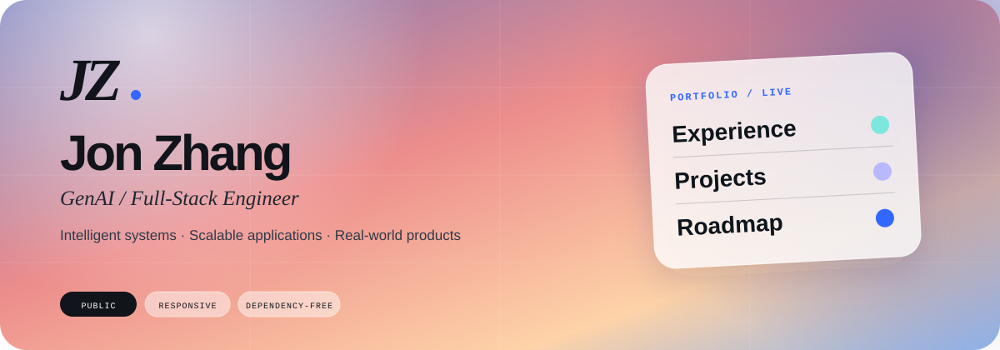
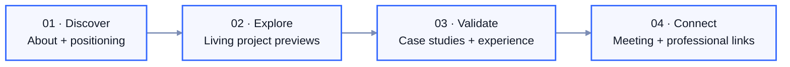

<p align="center">
  
</p>

<p align="center">
  <a href="https://jonzhang.dev"></a>
  <a href="https://omnigaze.jonzhang.dev"></a>
  <a href="https://afterglow.jonzhang.dev/"></a>
  <a href="https://courtvision.jonzhang.dev"></a>
  <a href="https://orbit.jonzhang.dev"></a>
  <a href="https://affinity.jonzhang.dev"></a>
  <a href="https://relay.jonzhang.dev"></a>
  <a href="https://axion.jonzhang.dev"></a>
  <a href="https://datacurrent.jonzhang.dev"></a>
  <a href="https://frasi-jazz-studio.perkyaisle4.chatgpt.site/"></a>
</p>

<p align="center">
  
  
  
  
</p>

<h1 align="center">Jon Zhang — Portfolio</h1>

<p align="center">
  A responsive, interactive portfolio for a <strong>GenAI / Full-Stack Engineer</strong><br />
  engineering AI systems that turn complex information into useful decisions.
</p>

---

## ✦ The experience

This portfolio is designed as an editorial product, not a résumé pasted into one long webpage. The homepage introduces Jon in depth, presents eight compact living project previews, and closes with evidence of activity plus a guided next step. Dedicated routes give experience, projects, and contact room to breathe—all inside the existing time-reactive visual atmosphere.

| Chapter | What visitors can explore |
| --- | --- |
| **Homepage** | Portrait-led About, eight living project previews, evidence of activity, and a guided next step |
| **Experience** | Editorial career timeline with consistent impact callouts, technical highlights, and education |
| **Projects** | Eight vertically arranged animated case cards using standardized Focus / Stack / Data / Systems / Status details |
| **Contact** | Meeting CTA plus an icon-led directory for LinkedIn, GitHub, résumé, Instagram, and Facebook |
| **Language** | Instant English and Simplified Chinese views with the visitor’s preference remembered locally |
| **Atmosphere** | A 24-hour interactive sky that shifts the page palette from sunrise through night |

## ◎ Design details

- Responsive glass-and-gradient visual system
- Clean static routes at `/experience`, `/projects`, and `/contact`
- Hash-addressable project cards that open directly from the homepage index
- Portrait-led editorial layout with compact animated project previews
- Local company and university assets
- Custom `JZ.` browser favicon
- Mobile layouts tuned independently from desktop
- Reduced-motion support for visitors who prefer it
- No application framework or runtime dependencies

## ⌁ Architecture

The portfolio is structured to answer four questions in order: **Who is Jon? What does he build? Where has he created impact? How can I connect?**



The homepage gives a concise overview, then guides visitors into detailed project and experience pages. Every deeper route keeps a clear next step toward live products, source code, or a direct conversation.

## ⌘ Project map

```text
jon-portfolio/
├── .github/
│   └── workflows/
│       └── deploy-pages.yml  # GitHub Pages deployment
├── .openai/
│   └── hosting.json          # ChatGPT Sites configuration
├── dist/
│   ├── CNAME                 # jonzhang.dev custom domain
│   ├── assets/
│   │   ├── favicon.svg       # JZ. site mark
│   │   ├── jon-portrait.png  # Homepage portrait
│   │   └── logos/            # Company and university assets
│   ├── app.js                # Language, time theme, and preview animations
│   ├── contact/index.html    # Meeting and contact directory
│   ├── experience/index.html # Experience route
│   ├── projects/index.html   # Project case-card route
│   ├── index.html            # About, project grid, evidence, and next step
│   └── styles.css            # Layout and visual system
├── docs/
│   └── readme-hero.svg       # Repository artwork
└── README.md
```

## ↗ Links

- **Portfolio:** [jonzhang.dev](https://jonzhang.dev) · [source](https://github.com/jonxsong/jonzhang)
- **Omnigaze:** [omnigaze.jonzhang.dev](https://omnigaze.jonzhang.dev) · [source](https://github.com/jonxsong/omnigaze)
- **Afterglow:** [https://afterglow.jonzhang.dev](https://afterglow.jonzhang.dev) · [source](https://github.com/jonxsong/afterglow)
- **CourtVision:** [courtvision.jonzhang.dev](https://courtvision.jonzhang.dev) · [source](https://github.com/jonxsong/courtvision)
- **Orbit:** [orbit.jonzhang.dev](https://orbit.jonzhang.dev) · [source](https://github.com/jonxsong/orbit)
- **Affinity:** [affinity.jonzhang.dev](https://affinity.jonzhang.dev) · [source](https://github.com/jonxsong/Affinity)
- **Relay:** [relay.jonzhang.dev](https://relay.jonzhang.dev) · [source](https://github.com/jonxsong/Relay)
- **Axion:** [axion.jonzhang.dev](https://axion.jonzhang.dev) · [source](https://github.com/jonxsong/Axion)
- **DataCurrent:** [datacurrent.jonzhang.dev](https://datacurrent.jonzhang.dev) · [source](https://github.com/jonxsong/DataCurrent)
- **Frasi:** [frasi-jazz-studio.perkyaisle4.chatgpt.site](https://frasi-jazz-studio.perkyaisle4.chatgpt.site) · [source](https://github.com/jonxsong/Frasi)
- **GitHub:** [github.com/jonxsong](https://github.com/jonxsong)
- **LinkedIn:** [linkedin.com/in/jonxsong](https://www.linkedin.com/in/jonxsong/)

---

<p align="center">
  <sub>Designed and engineered by Jon Zhang · GenAI × Engineering × Product</sub>
</p>
