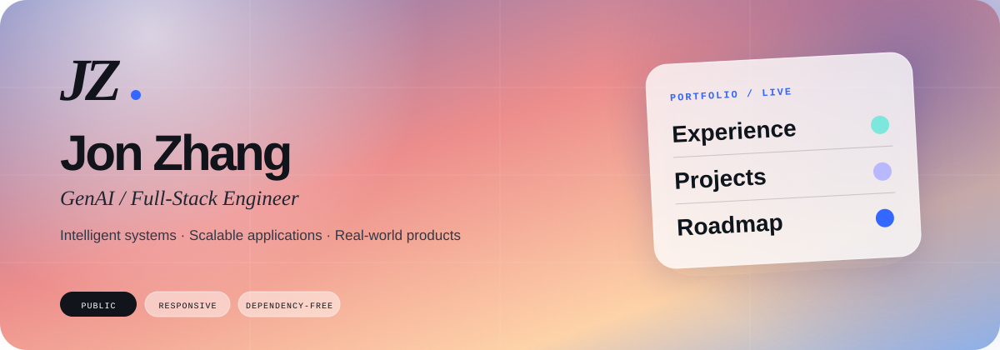
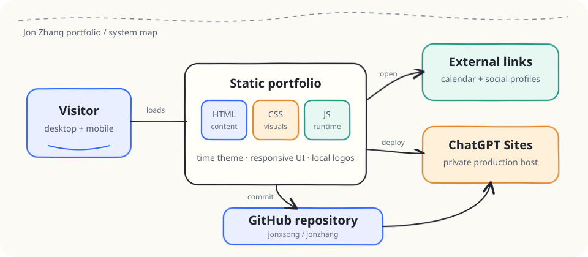

<p align="center">
  
</p>

<p align="center">
  <a href="https://jonzhang.dev"></a>
  <a href="https://omnigaze.jonzhang.dev"></a>
  <a href="https://courtvision.jonzhang.dev"></a>
  <a href="https://orbit.jonzhang.dev"></a>
</p>

<p align="center">
  
  
  
  
</p>

<h1 align="center">Jon Zhang — Portfolio</h1>

<p align="center">
  A responsive, interactive portfolio for a <strong>GenAI / Full-Stack Engineer</strong><br />
  building intelligent systems and turning ambitious ideas into real-world products.
</p>

---

## ✦ The experience

This portfolio is designed as a narrative, not a résumé pasted into a webpage. Visitors move from Jon’s professional experience into selected work and an interactive life roadmap—all inside a time-reactive visual atmosphere.

| Chapter | What visitors can explore |
| --- | --- |
| **Work experience** | Expandable company profiles with role, period, team, location, context, and highlights |
| **Selected work** | Four clickable, animated case studies—Omnigaze, Afterglow, CourtVision, and Orbit—with standardized Focus / Stack / Data / Systems / Status details |
| **Life roadmap** | Clickable milestones connecting education, internships, engineering roles, and the current GenAI chapter |
| **Language** | Instant English and Simplified Chinese views with the visitor’s preference remembered locally |
| **Personal links** | Instagram, Facebook, LinkedIn, GitHub, résumé, and meeting links with visual previews |
| **Atmosphere** | A 24-hour interactive sky that shifts the page palette from sunrise through night |

## ◎ Design details

- Responsive glass-and-gradient visual system
- Keyboard-accessible experience accordions and roadmap tabs
- Hover and focus previews for external profile links
- Local company and university assets
- Custom `JZ.` browser favicon
- Mobile layouts tuned independently from desktop
- Reduced-motion support for visitors who prefer it
- No application framework or runtime dependencies

## ⌁ Architecture

<p align="center">
  
</p>

The committed `dist/` directory is the product. HTML owns the content and semantics, CSS provides the visual system and responsive behavior, and a small JavaScript layer powers the time theme and interactive sections. GitHub Actions publishes the exact committed output to GitHub Pages at `jonzhang.dev`.

```text
Visitor
   │
   ▼
Static portfolio ──────► Social profiles · Résumé · Live apps
   │
   ├── index.html      content + structure
   ├── styles.css      visual system + responsive layout
   └── app.js          language, time theme + interactions
   │
   ├──────────────► GitHub Pages · jonzhang.dev
   └──────────────► GitHub source repository
```

## ⚡ Run locally

No install step is required. Serve the static output directly:

```sh
python -m http.server 4173 --directory dist
```

Then visit [http://localhost:4173](http://localhost:4173).

## ⌘ Project map

```text
jon-portfolio/
├── .github/
│   └── workflows/
│       └── deploy-pages.yml  # GitHub Pages deployment
├── .openai/
│   └── hosting.json          # ChatGPT Sites configuration
├── dist/
│   ├── CNAME                 # jonzhang.dev custom domain
│   ├── assets/
│   │   ├── favicon.svg       # JZ. site mark
│   │   └── logos/            # Company and university assets
│   ├── app.js                # Theme and interaction logic
│   ├── index.html            # Portfolio content
│   └── styles.css            # Layout and visual system
├── docs/
│   ├── architecture.svg      # System map
│   └── readme-hero.svg       # Repository artwork
└── README.md
```

## ↗ Links

- **Portfolio:** [jonzhang.dev](https://jonzhang.dev)
- **Omnigaze:** [omnigaze.jonzhang.dev](https://omnigaze.jonzhang.dev)
- **Afterglow:** [afterglow-sky-forecast.perkyaisle4.chatgpt.site](https://afterglow-sky-forecast.perkyaisle4.chatgpt.site)
- **CourtVision:** [courtvision.jonzhang.dev](https://courtvision.jonzhang.dev)
- **Orbit:** [orbit.jonzhang.dev](https://orbit.jonzhang.dev)
- **GitHub:** [github.com/jonxsong](https://github.com/jonxsong)
- **LinkedIn:** [linkedin.com/in/jonxsong](https://www.linkedin.com/in/jonxsong/)

---

<p align="center">
  <sub>Designed and engineered by Jon Zhang · GenAI × Engineering × Product</sub>
</p>
